<p align="center"></p>

# bot-reborn

English | [中文](README.zh-CN.md)

> **A workbench that takes your AI gadget from idea to hardware.** Simulate it,
> wire it, flash it and configure it, with the AI brain running on your own
> computer. The demo below is the first gadget built on it.

**Turn a $4 toy robot into an AI robot, with an old phone as its body and your
computer as its brain.**

<p align="center"><a href="https://youtube.com/shorts/SNA9ok1j0Sg">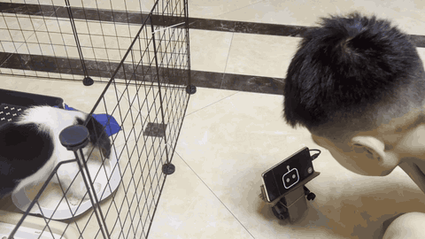</a></p>

*Real dog: busy eating. Robot dog: on duty.* — [watch the Short, with sound](https://youtube.com/shorts/SNA9ok1j0Sg)

**Not bought any parts yet? Wire it in your browser first.** Run the brain,
open the wiring simulator, click **Wire it for me** and watch an ESP32 get a
mic, a speaker and a screen in 40 seconds; then do it yourself, step by step,
until the dog shows up. No hardware needed — see [Build your own](#build-your-own).

<p align="center"><a href="https://youtube.com/shorts/0MMilmoEPdo">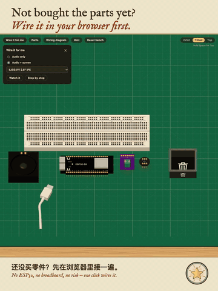</a></p>

**📖 The whole build story: [I turned a $4 toy robot into an AI robot that talks back](https://agentlenshq.com/maker/four-dollar-robot)**

<table>
  <tr>
    <td align="center">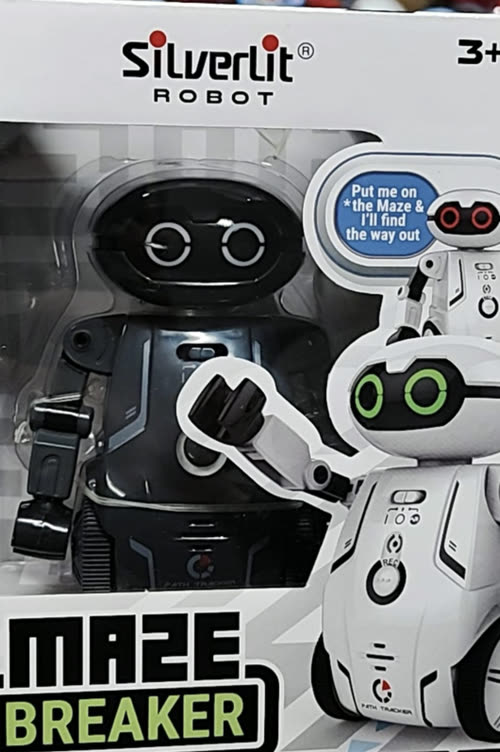</td>
    <td align="center">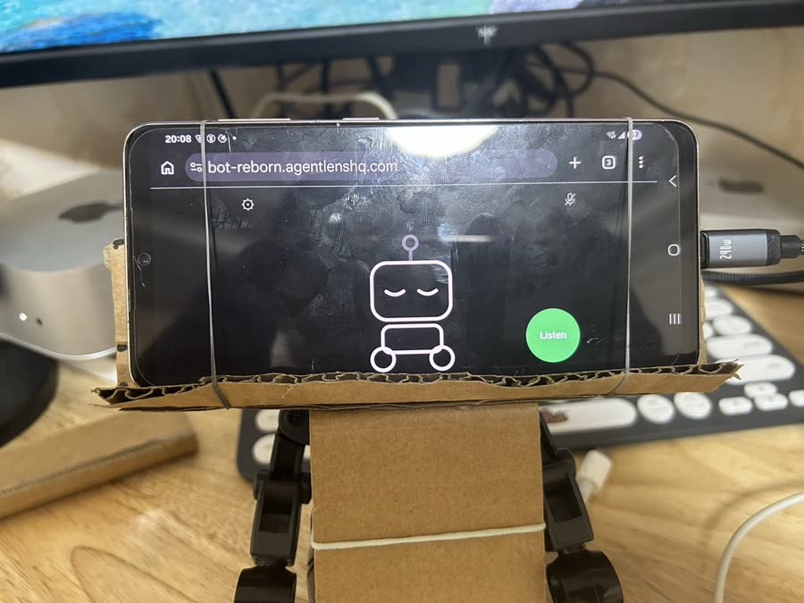</td>
  </tr>
  <tr>
    <td align="center">Before: a line-following toy</td>
    <td align="center">After: the head is gone, the phone is the face</td>
  </tr>
</table>

## More demos

<table>
  <tr>
    <td align="center" width="50%"><a href="https://youtube.com/shorts/3Y984t1W6nc">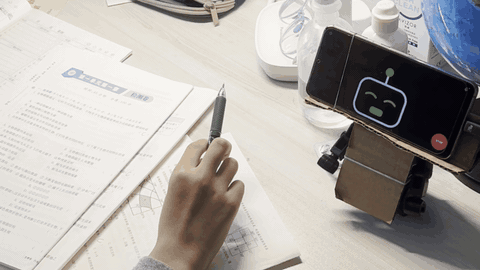</a><br>Kid: has questions. Robot: has attitude.</td>
    <td align="center" width="50%"><a href="https://youtube.com/shorts/zPd0V5mH7p4">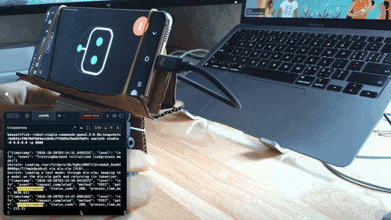</a><br>A spoken move, answered in about 200 ms by a 0.8B model on the computer — no LLM call.</td>
  </tr>
  <tr>
    <td align="center" width="50%"><a href="https://youtube.com/shorts/Y80lk1O1Z-0">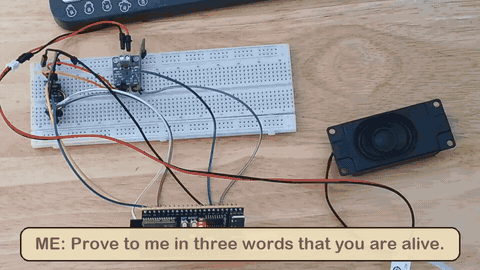</a><br>Asked to prove it's alive in three words: "Two copper wires."</td>
    <td align="center" width="50%"><a href="https://youtube.com/shorts/zxbSJz2M2tY">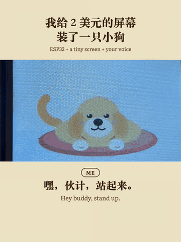</a><br>Now it has a face, and it listens: a dog on a $2 screen, no buttons, just a voice.</td>
  </tr>
</table>

Each GIF links to its Short, with sound.

## What it does

- **You talk, it drives and answers.** "Go forward two seconds, then turn
  left".
- **Reflexes, before the chat model thinks.** Optionally, a small decision
  model hears each line first and picks one of a few answers you wrote; each
  answer does what you set it to — play a sound, move, stop — or hands the
  turn to the chat model. Two presets come with it: *bark* (bark at it and it
  barks back) and *simple commands* ("stop", "come here", "turn left" act at
  once). Both are just data you can edit on the admin page.
- **It listens while its screen is on.** No wake word needed, though you can
  turn one on. Hit the stop button and the car stops, whatever it was doing.
- **A dog on a screen.** An ESP32-S3 body with a small SPI screen shows a pet
  dog that lies, sits, stands, shakes a paw and spins when you ask, in any
  language, and lies back down when nobody talks for ten seconds.
- **A tarot reader.** Give a character the tarot body and shake an MPU-6050
  wand (or mouse-shake it in the simulator): it shuffles on the screen, turns
  over a Rider-Waite-Smith card, and reads it aloud. Each draw is random.
- **Wire it before you buy it.** A wiring simulator in your browser lets you
  practise the ESP32 build on a virtual bench, where a mistake burns a virtual
  part.
- **Several characters, one brain.** Each robot is a character with its own
  name, voice, providers and keys, all set up from an admin page in your
  browser, in English or Chinese.

## What you need

Every build needs the brain, a computer on the same Wi-Fi as the body, plus
**API keys** for speech-to-text, a chat model and text-to-speech. Any
OpenAI-compatible provider works; the admin page has presets for common ones.
Then pick a body:

**ESP32 body** — talks, listens and shows a pet dog; no wheels yet.

- An **ESP32-S3** dev board, an **INMP441** microphone, a **MAX98357A** amp
  and a speaker, and a small SPI screen for the dog. Pin tables are in
  [`firmware/README.md`](firmware/README.md).
- **Chrome or Edge** and a USB cable, to set the board up from the admin page.

**Phone body** — drives a toy car.

- **A cheap toy robot or car** with a drive motor and steering. Ours is a
  Silverlit Maze Breaker. It is the only one tested so far, but
  any toy driven by the same kind of motor driver should work the same way.
- **An FT232H breakout board** — the bridge between the phone's USB port and
  the toy's motor driver.
- **An Android phone with Chrome.** The phone talks to the board over WebUSB,
  which iPhones do not have. Plus a USB-C cable to the board.
- A soldering iron, some wire, cardboard and rubber bands.

**For reflexes (optional):** a decision model — JEV, or one trained with
[Unsloth](https://github.com/unslothai/unsloth) and served at
`/v1/systemone`. The simple-commands preset asks exactly the question of the
model trained on [`training/commands/`](training/commands/).

No car yet? Set a character's body to **Dry run** and the moves are only
written to the brain's log, or to **Cannot move** for a robot that just talks. The
phone then needs no board at all.

## How it works

<p align="center">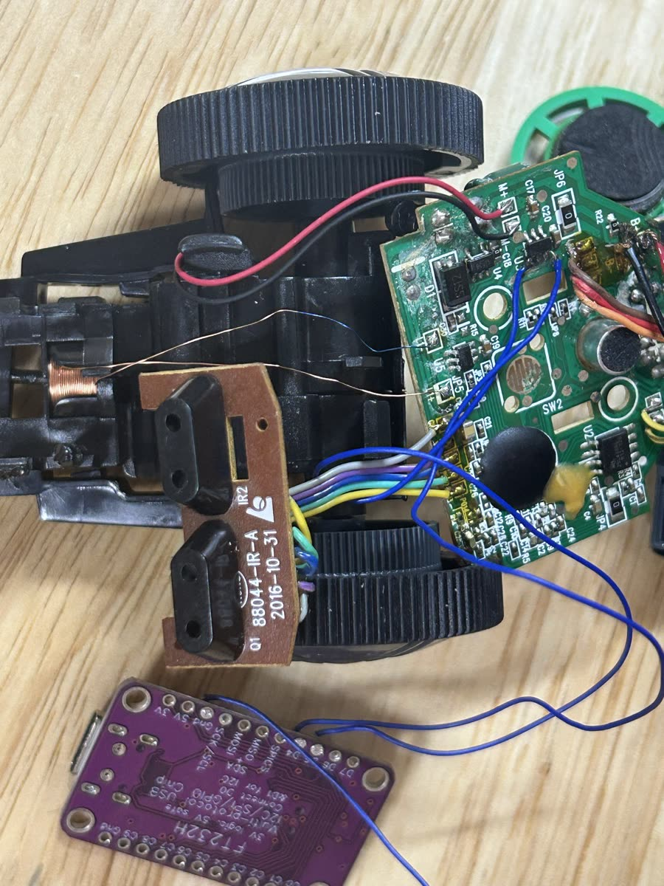</p>

The toy's own line-following chip is cut out of the loop. Four wires from the
FT232H go straight to the inputs of the toy's motor driver and steering coil,
and the phone switches those four pins over USB. The phone is the robot's
body: it listens, plays, drives and shows a face. Everything that decides —
hearing its name, understanding, choosing what to do, talking back — runs in a
small Node server on a computer on the same Wi-Fi, the robot's brain.

The brain started out inside the phone's browser and moved to the computer for
two reasons: everything that hears you can, in time, run locally on your own
machine — the reflex model already does — and the body can shrink to something
much smaller than a phone. A phone, it turns out, is heavy enough to tip the
car over when it backs up.

That smaller body is an ESP32-S3 ([`firmware/`](firmware/README.md)). It hears,
talks and shows a pet dog on a small screen, on a breadboard with no wheels
yet. You flash and set it up from the admin page in Chrome, over one USB
cable, and it finds the brain on its own.

## The reflex model

"Stop" should stop the car now, not after a speech-to-text, chat model and
text-to-speech round trip. So before the chat model sees a line, a 0.8B
decision model reads it and picks one simple move — `stop`, `forward`,
`backward`, `left`, `right`, `keep_going` — or `pass`, which hands the turn to
the chat model. It answers with a probability, not text, which is why it is
fast: about 200 ms from transcript to move on a Mac mini M4, with no voice in
the reply, only the action.

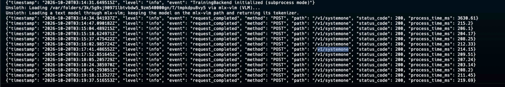

It scores 86.6% on its test set (142 of 164). In use it does better than that
number suggests, because a move fires only above 0.8: anything it is unsure of
is passed to the chat model, which is slower but does not lurch the car off.
Getting a reflex wrong is worse than getting it late.

- **Trained with** Unsloth's decision-model recipe:
  [Train your own decision model with Unsloth](https://unsloth.ai/docs/basics/train-your-own-decision-model-with-unsloth)
- **Dataset:** [`beasaltfish/robot-simple-commands`](https://huggingface.co/datasets/beasaltfish/robot-simple-commands)
  — built by [`training/commands/`](training/commands/)
- **Model:** [`beasaltfish/robot-simple-commands-qwen3.5-0.8b`](https://huggingface.co/beasaltfish/robot-simple-commands-qwen3.5-0.8b)
  ([GGUF](https://huggingface.co/beasaltfish/robot-simple-commands-qwen3.5-0.8b-GGUF))

It is English only. A command in another language should score low and fall
through to the chat model, but that is untested.

## Build your own

1. **Start the brain** on a computer on the same Wi-Fi as the body:

   ```bash
   npm install
   server/models/fetch.sh   # the wake-word and VAD models, once
   npm start
   ```

   The admin page opens in your browser. Make a character, pick what body it
   has, and give each layer (ears, mind, voice, and optionally reflex) a
   provider and key; the page tests each one as you type it, and a second
   character can copy providers, keys included, from the first.

   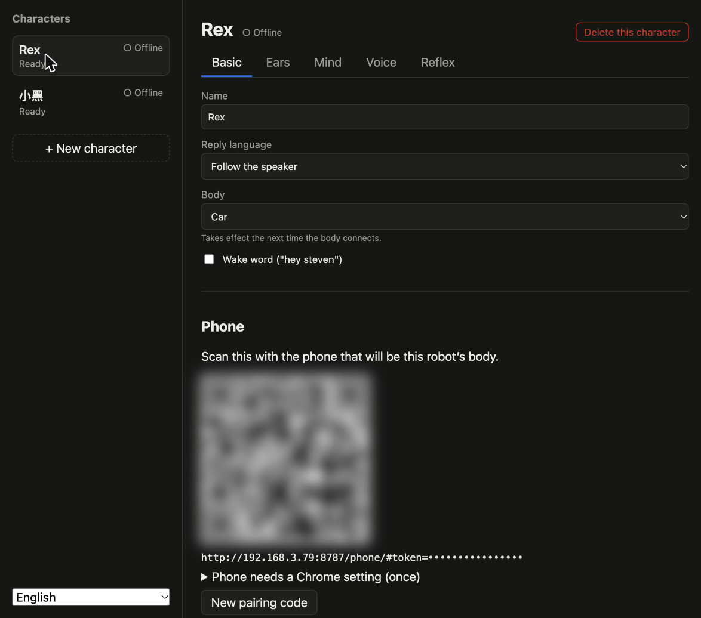
2. **Practice first (optional).** With the brain running, open
   <http://localhost:8787/sim/> (or follow the link in the admin sidebar) and
   wire the audio on a virtual bench: **Wire it for me** shows you how, then
   you do it yourself. A mistake burns a virtual part, not a real one. It opens
   only on the computer the brain runs on.
3. **Build a body.** Pick one:

   **ESP32 body**
   - **Wire it.** The pin tables for the mic, amp and screen are in
     [`firmware/README.md`](firmware/README.md#wiring).
   - **Set the board up.** Open the admin page in Chrome or Edge, plug the
     board into the port marked **USB**, and click **Set up a board**. "First
     time" writes the firmware, the Wi-Fi and the character's token; no
     ESP-IDF needed. The board finds the brain by itself.
   - Turn **Barge-in off** for this character: the body has no echo
     cancellation, so it would hear itself and interrupt itself. If something
     goes wrong, [`docs/esp32-lessons.md`](docs/esp32-lessons.md) lists the
     faults this board has actually had.

   **Phone body**
   - **Wire it.** Pin map, wiring and measurements are in
     [`docs/hardware.md`](docs/hardware.md). Read its D6/D7 soldering warning
     before you start.
   - **Let Chrome on the phone use USB and the microphone on that page**, once
     per phone: open `chrome://flags/#unsafely-treat-insecure-origin-as-secure`,
     add the address the admin page shows (`http://<computer>:8787`), set it to
     Enabled and relaunch Chrome. The page is plain http on your own network,
     and Chrome only allows USB and the microphone on a page it treats as
     secure. Giving the computer a fixed address on your router saves redoing
     this.
   - **Scan the character's QR code** on the admin page with the phone, plug
     the board in, and press Listen. The robot shows what it is still missing,
     and each missing part is a step: plugging in the board, and teaching it
     which way is left. A phone with no board plugged in still listens and
     talks.

Your keys stay on the computer, in a file under `~/.bot-reborn/` that only your
user can read, and are sent only to the providers you chose. The phone never
sees them: it holds a token that says which character it is. See
[Security](docs/development.md#security).

## Status

**Phone body:** works end to end on one robot and one phone. The
simple-commands reflex has been driven by a real voice on the car (see the
reflex demo above) and the 0.8 threshold holds up; the bark preset is still on
its first guess. The phone is top-heavy and has tipped the car over backing up.

**ESP32 body:** hears, talks and shows a pet dog on a breadboard, set up from
the admin page. It does not drive a car yet, which is the next step, along
with choosing the screen from the admin page. The tarot wand works in the
simulator; the firmware reads it too, but that has not been tried on a real
board yet.

Some hardware numbers are still unmeasured.

## More

- [`firmware/README.md`](firmware/README.md) — the ESP32 body: pins, flashing, setup
- [`docs/esp32-lessons.md`](docs/esp32-lessons.md) — faults the ESP32 board has had
- [`docs/hardware.md`](docs/hardware.md) — the toy car's wiring, pin map, every measurement
- [`docs/development.md`](docs/development.md) — reading the code, running it,
  tests, security
- [`docs/instruments.md`](docs/instruments.md) — the calibration page behind
  the gear
- [`docs/ui.md`](docs/ui.md) — the robot's face and what each state means
- [`docs/promo-video.md`](docs/promo-video.md) — what making the video taught us
- [`training/commands/`](training/commands/) — the simple-commands dataset,
  its builder and model card

## License

[MIT](LICENSE). The sounds in `server/sounds/` are CC0 — see their
[credits](server/sounds/CREDITS.md).
