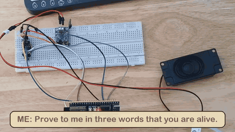
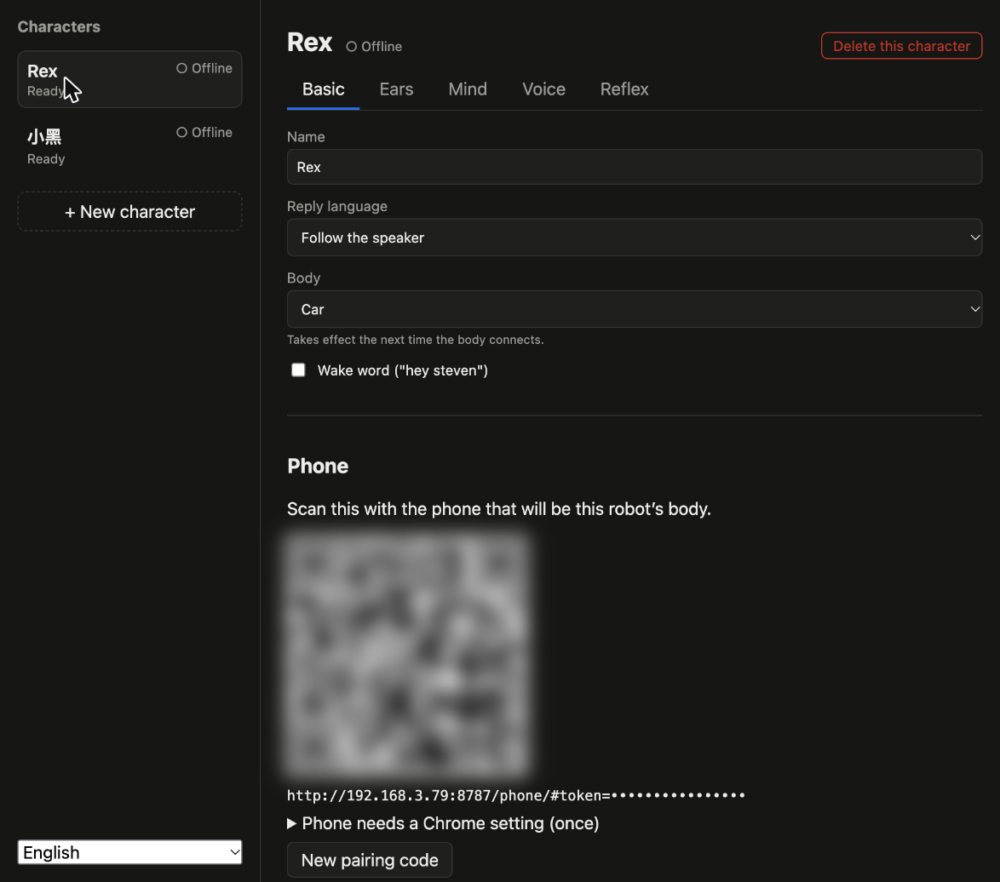
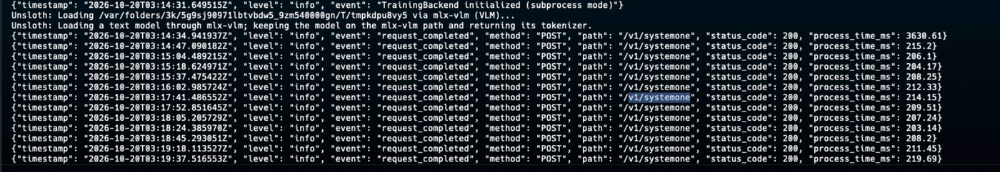
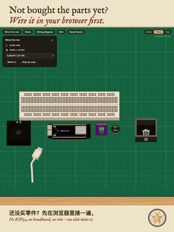

<p align="center"></p>

# bot-reborn

English | [中文](README.zh-CN.md)

> **A brain you configure, and a workbench to build it on.** Turn an ESP32-S3 or
> an old phone into a robot with a voice and a character — wire it, flash it and
> set it up from one page, before you buy a single part.

<p align="center"><a href="https://youtube.com/shorts/Y80lk1O1Z-0"></a></p>

*Asked to prove it's alive in three words: "Two copper wires."* — [watch the Short, with sound](https://youtube.com/shorts/Y80lk1O1Z-0)

## What you can build

Three gadgets that have already been built on this platform, plus the route
that needs no parts at all. Each is a different body on the same brain.

- **A desk companion that talks back.** An ESP32-S3, a microphone, an amp and a
  speaker on a breadboard, with a screen for a face.
  [1 min](https://youtube.com/shorts/Y80lk1O1Z-0)
- **A toy car that drives on a spoken command.** A $4 toy, a phone as its body,
  and a reflex model that answers a move in about 200 ms.
  [40 s](https://youtube.com/shorts/zPd0V5mH7p4)
- **A pet on a screen.** It sits, shakes a paw and lies back down when nobody
  talks to it.
  [30 s](https://youtube.com/shorts/zxbSJz2M2tY)
- **Or none of them yet:** [wire the whole thing in a browser first](#five-minutes-no-parts).
  A mistake burns a virtual part, not a real one.

The gadgets came before the platform: [how the first one was built](docs/story.md).

## The brain and its characters

A small Node server on your computer is the brain. It hears, understands,
decides and speaks. Every robot it drives is a **character** — and a character
is data, not code: one page in the admin app, and a second character can copy
providers from the first, keys included.

Four layers, each given its own provider and key:

- **Ears** — speech to text.
- **Mind** — the chat model, plus the persona that decides who it is and how it
  talks, in any language.
- **Voice** — text to speech.
- **Reflex** — optionally, a small decision model that sees each line first and
  picks one action, so "stop" stops the car now rather than after a chat round
  trip.

Any OpenAI-compatible provider works; the admin page ships presets and tests
each key as you type it. Keys stay on the computer, in a file under
`~/.bot-reborn/` that only your user can read, and are sent only to the
providers you chose. The robot never sees them: it holds a token that says
which character it is.



### Reflex, as an example of a layer

Before the chat model sees a line, a 0.8B decision model reads it and picks one
move — `stop`, `forward`, `backward`, `left`, `right`, `keep_going` — or
`pass`, which hands the turn to the chat model. It answers with a probability,
not text, which is why it is fast: about 200 ms from transcript to move on a
Mac mini M4, with no voice in the reply, only the action.



It scores 86.6% on its test set (142 of 164). In use it does better than that
number suggests, because a move fires only above 0.8: anything it is unsure of
is passed to the chat model, which is slower but does not lurch the car off.
Getting a reflex wrong is worse than getting it late.

- **Trained with** [Unsloth's decision-model recipe](https://unsloth.ai/docs/basics/train-your-own-decision-model-with-unsloth)
- **Dataset:** [`beasaltfish/robot-simple-commands`](https://huggingface.co/datasets/beasaltfish/robot-simple-commands) — built by [`training/commands/`](training/commands/)
- **Model:** [`beasaltfish/robot-simple-commands-qwen3.5-0.8b`](https://huggingface.co/beasaltfish/robot-simple-commands-qwen3.5-0.8b)
  ([GGUF](https://huggingface.co/beasaltfish/robot-simple-commands-qwen3.5-0.8b-GGUF))

It is English only. A command in another language should score low and fall
through to the chat model, but that is untested.

## The workbench

The wiring simulator is a bench in your browser, at `/sim/` on the brain's own
machine. It exists so the first hour of a build costs nothing:

- **Wire it by hand**, hole by hole: a seated pin's wire ends in a free hole on
  the same strip, and the netlist is computed from what you actually built.
- **Wire it for me** does the audio build in about forty seconds, then hands it
  back so you can do it yourself.
- **Mistakes are bounded, and some of them burn a virtual part** — a reversed
  supply is the classic.
- **Eleven device families** come with a bilingual five-stage lesson each, and
  there are nine guided projects that build something small and check it.

<p align="center"><a href="https://youtube.com/shorts/0MMilmoEPdo"></a></p>

Power, current, level and bus checks are bounded models, not SPICE. Firmware
support is reported separately, and the table below is the honest version of
it. The firmware studio can build and run a sketch against the bench without
touching a board.

## Five minutes, no parts

1. **Start the brain** on a computer on the same Wi-Fi as the body:

   ```bash
   npm install
   server/models/fetch.sh   # the wake-word and VAD models, once
   npm start
   ```

   The admin page opens in your browser.
2. **Open the workbench:** <http://localhost:8787/sim/> (or the link in the
   admin sidebar). It opens only on the computer the brain runs on.
3. **Press Wire it for me.** An ESP32 gets a microphone, an amp and a speaker,
   then a screen, then the dog shows up on it. Undo it, and do it yourself.

No parts, no keys, no hardware. When you want the real one, keep reading.

## Real hardware

Every build needs the brain, a computer on the same Wi-Fi as the body, plus
**API keys** for speech-to-text, a chat model and text-to-speech. Then pick a
body.

### ESP32 body

Talking, listening, and a pet dog on a screen. It does not drive a car yet.

- An **ESP32-S3** dev board, an **INMP441** microphone, a **MAX98357A** amp and
  a speaker, and a small SPI screen. Pin tables are in
  [`firmware/README.md`](firmware/README.md#wiring).
- **Chrome or Edge** and a USB cable. Open the admin page, plug the board into
  the port marked **USB**, and click **Set up a board**: "First time" writes the
  firmware, the Wi-Fi and the character's token, with no ESP-IDF to install. The
  board finds the brain on its own.
- Turn **Barge-in off** for this character. The body has no echo cancellation,
  so it would hear itself and interrupt itself.

### Phone body

Drives a toy car.

- **A cheap toy robot or car** with a drive motor and steering. Ours is a
  Silverlit Maze Breaker — the only one tested, but any toy on the same kind of
  motor driver should behave the same way.
- **An FT232H breakout** — the bridge between the phone's USB port and the
  toy's motor driver — plus a soldering iron, wire, cardboard and rubber bands.
- **An Android phone with Chrome.** The phone talks to the board over WebUSB,
  which iPhones do not have.
- Let Chrome use USB and the microphone on that page, once per phone: open
  `chrome://flags/#unsafely-treat-insecure-origin-as-secure`, add the address
  the admin page shows, set it to Enabled, relaunch. Read the **D6/D7 soldering
  warning** in [`docs/hardware.md`](docs/hardware.md) before you cut anything.
- **Scan the character's QR code**, plug the board in, and press Listen. The
  robot shows what it is still missing, and each missing part is a step.

No car yet? Set a character's body to **Dry run** and the moves only reach the
brain's log, or to **Cannot move** for a robot that just talks.

## What runs where

The workbench models more than the real firmware implements — on purpose. This
table is which is which:

| Device | Simulated | On real firmware | Lesson |
|---|---|---|---|
| LED and resistor | yes | — | yes |
| Push button, two-terminal | yes | — | yes |
| Button module (KY-004) | yes | — | yes |
| HC-SR04 distance | yes | — | yes |
| BME280 environment | yes | — | yes |
| SSD1306 OLED | yes | — | yes |
| SG90 servo | yes | — | yes |
| TB6612FNG + DC motor | yes | — | yes |
| WS2812 strip | yes | — | yes |
| Power: USB, 4×AA, bench, MB102 | yes | USB only | yes |

The real firmware still implements only the original body: the INMP441
microphone, the MAX98357A amp and speaker, a screen, and four motor pins on
GPIO 4–7 for the car. Everything else in that table is something the workbench
can teach and the board cannot run yet.

### What a body can do

| Body | Moves | Shows | Needs |
|---|---|---|---|
| Car | drives, cruises, stops | a face | phone + FT232H |
| Pet on a screen | poses, barks | a dog | a screen |
| Tarot | no | cards | an MPU-6050 wand |
| Dry run | logged only | a face | nothing |
| Cannot move | no | a face | nothing |

## Status and limits

**Phone body:** works end to end on one robot and one phone. The
simple-commands reflex has been driven by a real voice on the car and the 0.8
threshold holds up; the bark preset is still on its first guess. The phone is
top-heavy and has tipped the car over backing up.

**ESP32 body:** hears, talks and shows a pet dog on a breadboard, set up from
the admin page. It does not drive a car yet, which is the next step, along with
choosing the screen from the admin page. The tarot wand works in the simulator;
the firmware reads it too, but that has not been tried on a real board yet.

Some hardware numbers are still unmeasured.

## More

- [`firmware/README.md`](firmware/README.md) — the ESP32 body: pins, flashing, setup
- [`docs/story.md`](docs/story.md) — the gadget this platform came out of
- [`docs/hardware.md`](docs/hardware.md) — the toy car's wiring, pin map, every measurement
- [`docs/esp32-lessons.md`](docs/esp32-lessons.md) — faults the ESP32 board has had
- [`docs/development.md`](docs/development.md) — reading the code, running it, tests, security
- [`docs/instruments.md`](docs/instruments.md) — the calibration page behind the gear
- [`docs/ui.md`](docs/ui.md) — the robot's face and what each state means
- [`docs/promo-video.md`](docs/promo-video.md) — what making the video taught us
- [`training/commands/`](training/commands/) — the simple-commands dataset, its builder and model card

## License

[MIT](LICENSE). The sounds in `server/sounds/` are CC0 — see their
[credits](server/sounds/CREDITS.md).
