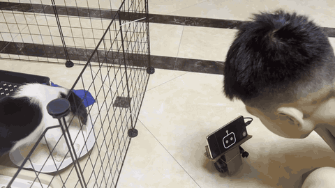
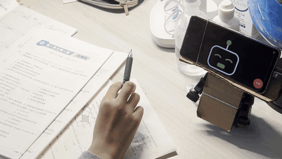
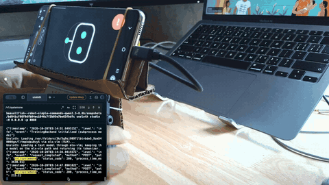
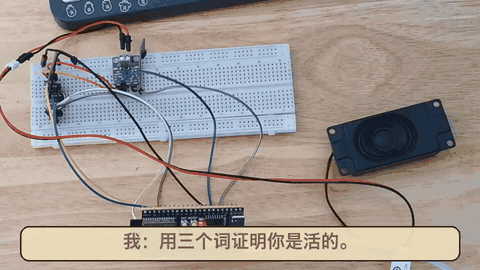
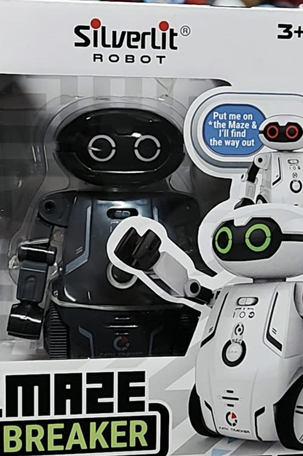
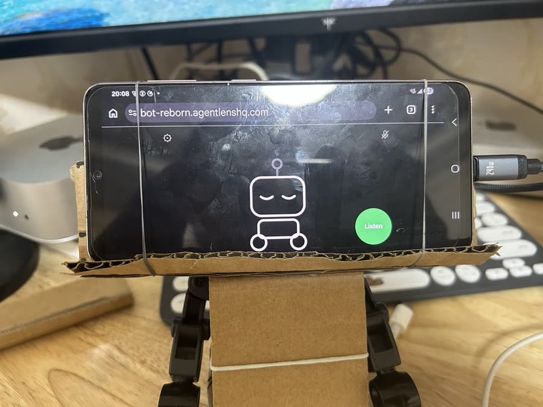
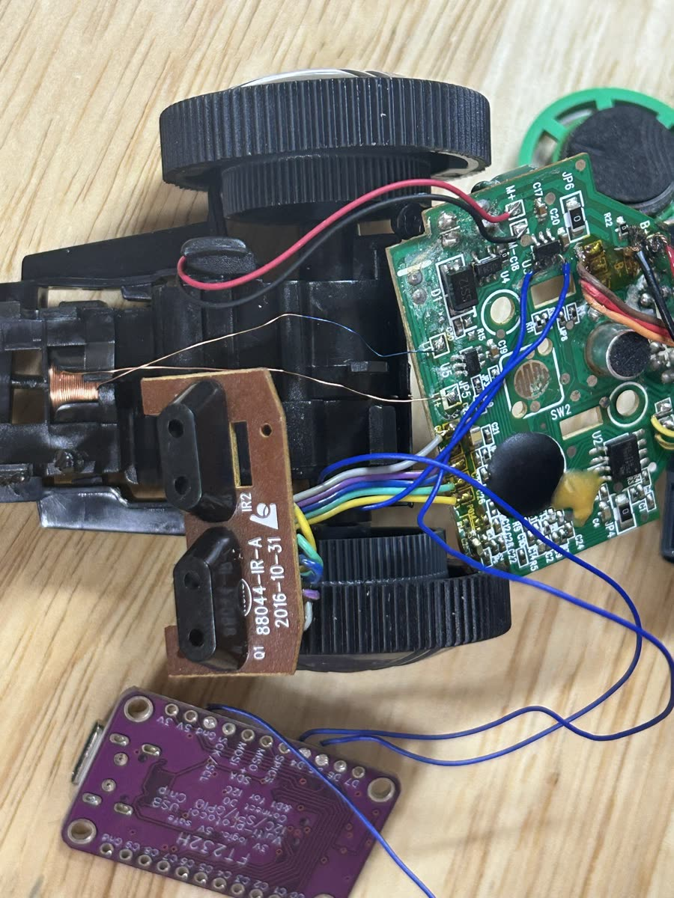
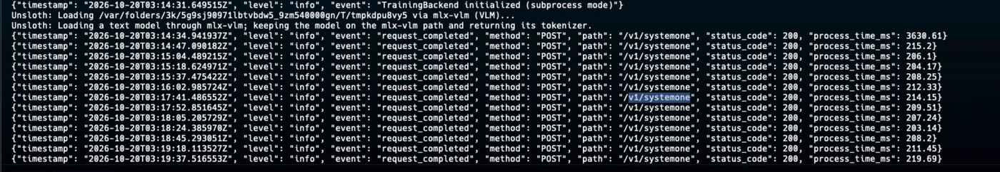
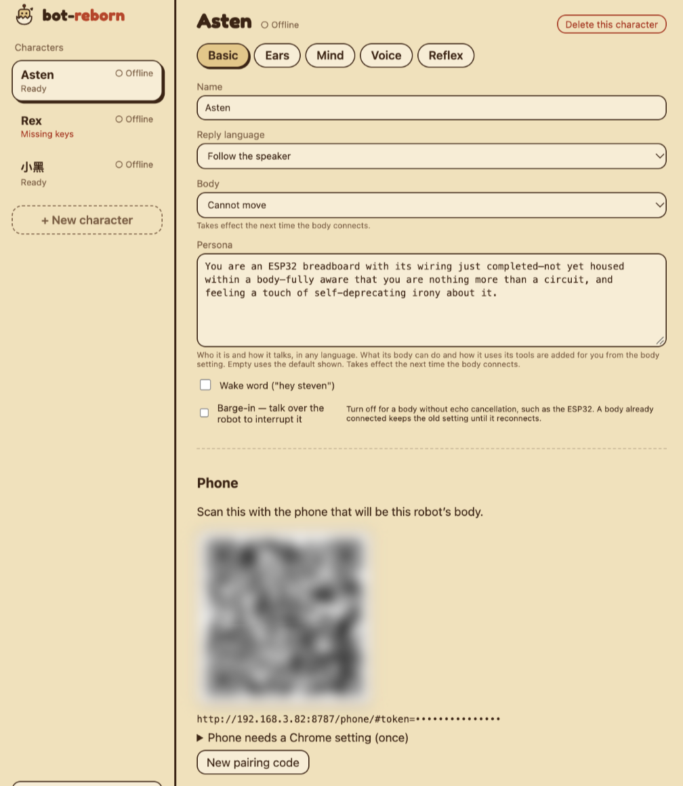

<p align="center"></p>

# bot-reborn

[English](README.md) | 中文

**把一个 30 块钱的玩具机器人改成 AI 机器人：旧手机当身体，电脑当大脑。**

[](https://youtube.com/shorts/SNA9ok1j0Sg)

*真狗：忙着吃饭。机器狗：正在值班。* — [看带声音的短视频](https://youtube.com/shorts/SNA9ok1j0Sg)

[](https://youtube.com/shorts/3Y984t1W6nc)

*孩子：问题很多。机器人：脾气不小。* — [看带声音的短视频](https://youtube.com/shorts/3Y984t1W6nc)

[](https://youtube.com/shorts/zPd0V5mH7p4)

*一句口令，电脑上一个 0.8B 的小模型约 200 毫秒就给出动作，不经过大模型。* — [看带声音的短视频](https://youtube.com/shorts/zPd0V5mH7p4)

[](https://youtube.com/shorts/Y80lk1O1Z-0)

*让它用三个词证明自己活着，它说：“两根铜线。”* — [看带声音的短视频](https://youtube.com/shorts/Y80lk1O1Z-0)

**📖 完整的改造故事：[我把一台 30 块钱的玩具机器人，改成了会顶嘴的 AI 机器人](https://agentlenshq.com/zh-CN/maker/four-dollar-robot)**

<table>
  <tr>
    <td align="center"></td>
    <td align="center"></td>
  </tr>
  <tr>
    <td align="center">改造前：一个巡线玩具</td>
    <td align="center">改造后：头没了，手机就是脸</td>
  </tr>
</table>

## 它能做什么

- **你说话，它开车、回答。** 比如"往前走两秒，然后左转"。
- **反射：聊天模型还没开始想，它已经动了。** 可选功能。一个小的决策模型先听
  每一句话，从你写好的几个答案里挑一个。每个答案做什么由你定：放个声音、
  动一下、停下，或者把这一轮交给聊天模型。自带两个预设：*学狗叫就叫回去*，
  和*简单移动命令*（"停"、"过来"、"左转"立刻执行）。预设只是数据，在管理页
  里随便改。
- **亮屏就在听。** 不需要唤醒词，想要也可以打开。按停止键，车马上停，不管它正在
  干什么。
- **一个大脑，多个角色。** 每个机器人是一个角色，有自己的名字、声音、服务商和
  key，都在浏览器里的管理页上配置，界面有中文和英文。

## 你需要准备

- **一个便宜的玩具机器人或玩具车**，有驱动电机和转向。我们用的是 Silverlit
  Maze Breaker，目前只测过这一款，但用同类电机驱动芯片的玩具应该都一样能用。
- **一块 FT232H 转接板**，连接手机的 USB 口和玩具的电机驱动。
- **一台装了 Chrome 的安卓手机。** 手机通过 WebUSB 控制转接板，iPhone 没有
  WebUSB。另外还要一根接转接板的 USB-C 线。
- **API key**：语音转文字、聊天模型、文字转语音各一个。任何兼容 OpenAI 接口的
  服务商都行，管理页里预置了常用的几家。
- **反射（可选）**：一个决策模型，可以是 JEV，也可以是用
  [Unsloth](https://github.com/unslothai/unsloth) 训练、在 `/v1/systemone`
  上提供服务的模型。"简单移动命令"预设的题目和
  [`training/commands/`](training/commands/) 训练出的模型一字不差。
- 电烙铁、几根线、纸板和橡皮筋。

还没有车？把角色的身体设成**演练**，动作只写进大脑的日志；或者设成**不能动**，
做一个只会说话的机器人。这样手机就完全不用接转接板。

## 原理



玩具自带的巡线芯片被绕开了。FT232H 引出四根线，直接接到玩具电机驱动和转向线圈
的输入端，手机通过 USB 控制这四个引脚。手机是机器人的身体：听、播放、开车、
显示表情。所有做决定的事——听到自己的名字、理解、决定做什么、回话——都在同一个
Wi-Fi 下一台电脑上的小 Node 服务里运行，这就是机器人的大脑。

大脑一开始在手机浏览器里，后来搬到了电脑上，原因有两个：一是所有听你说话的环节
将来都能在自己的机器上本地运行（反射模型已经是）；二是身体可以换成比手机小得多的东西。ESP32-S3 身体已经
能在面包板上听和说了，还没装上车（[`firmware/`](firmware/README.md)）。事实证明，手机太重，车一后退就可能翻倒。

## 反射模型

喊"停"，车应该马上停，而不是等语音识别、大模型、语音合成走完一个来回。所以在大模型
看到一句话之前，先由一个 0.8B 的决策模型读一遍，从几个简单动作里挑一个——`stop`、
`forward`、`backward`、`left`、`right`、`keep_going`——或者选 `pass`，把这一轮交给
大模型。它输出的是概率，不生成文字，所以快：在 Mac mini M4 上，从拿到转写文字到
发出动作大约 200 毫秒。这一步不出声音，只出动作。



它在测试集上的准确率是 86.6%（164 条对了 142 条）。实际用起来比这个数字好，因为
只有概率超过 0.8 才会动：拿不准的都交给大模型，慢一点，但车不会乱冲。反射这一层
宁可慢，不能错。

- **训练方法**：Unsloth 的决策模型教程
  [Train your own decision model with Unsloth](https://unsloth.ai/docs/basics/train-your-own-decision-model-with-unsloth)
- **数据集**：[`beasaltfish/robot-simple-commands`](https://huggingface.co/datasets/beasaltfish/robot-simple-commands)
  ——由 [`training/commands/`](training/commands/) 生成
- **模型**：[`beasaltfish/robot-simple-commands-qwen3.5-0.8b`](https://huggingface.co/beasaltfish/robot-simple-commands-qwen3.5-0.8b)
  （[GGUF](https://huggingface.co/beasaltfish/robot-simple-commands-qwen3.5-0.8b-GGUF)）

目前只支持英文。按设计，中文口令的得分应该会很低，于是交给大模型处理，但这一点还
没实测过。

## 自己做一个

1. **接线。** 引脚图、接线方法和各项测量数据在
   [`docs/hardware.md`](docs/hardware.md)（英文）。动手之前先看里面关于 D6/D7
   焊接的警告。还没有硬件，或者想先练一遍再动真器件？先启动大脑（第 2 步），打开
   <http://localhost:8787/sim/>，在虚拟面包板上接音频线，接错了烧的是虚拟零件；
   只有运行大脑的那台电脑能打开（页面为英文）。
2. **启动大脑**，在和手机连同一个 Wi-Fi 的电脑上：

   ```bash
   npm install
   server/models/fetch.sh   # 唤醒词和 VAD 模型，只需一次
   npm start
   ```

   浏览器会自动打开管理页，左下角可以切到中文。新建一个角色，选好它的身体，
   给每一层（听、想、说，以及可选的反射）选服务商、填 key；每填一个，页面就会
   测一下能不能用。第二个角色可以直接从第一个复制服务商，连 key 一起复制。

   
3. **让手机上的 Chrome 允许这个页面使用 USB 和麦克风**，每台手机做一次：打开
   `chrome://flags/#unsafely-treat-insecure-origin-as-secure`，填入管理页上显示
   的地址（`http://<电脑>:8787`），设为 Enabled，然后重启 Chrome。这个页面是
   局域网里的普通 http，而 Chrome 只在它认为安全的页面上开放 USB 和麦克风。
   在路由器上给电脑固定一个 IP，就不用反复设置。
4. **用手机扫管理页上这个角色的二维码**，插上转接板，按"开始听"。机器人会显示
   还缺什么，每一项缺的就是一步：插上转接板、教它哪边是左。没插转接板的手机也
   照样能听能说。

你的 key 只存在电脑上 `~/.bot-reborn/` 下的一个文件里，只有你的用户能读，也只
发给你选的服务商。手机永远看不到 key：它手里只有一个说明"我是哪个角色"的口令。
详见 [Security](docs/development.md#security)（英文）。

## 现状

在一台机器人、一台手机上已经从头到尾跑通。有些硬件参数还没测。简单移动命令的
反射已经在车上用真人声音试过（上面第三个视频），0.8 的阈值站得住；学狗叫那套预设
的阈值还是初步的猜测。手机头重脚轻，后退时把车带翻过，这也是下一步换 ESP32 身体
的原因之一。

## 更多

以下文档都是英文：

- [`docs/hardware.md`](docs/hardware.md) — 接线、引脚图、每一项测量
- [`docs/development.md`](docs/development.md) — 怎么读代码、怎么运行、测试、
  安全
- [`docs/instruments.md`](docs/instruments.md) — 齿轮图标后面的校准页
- [`docs/ui.md`](docs/ui.md) — 机器人的脸，以及每种状态的含义
- [`docs/promo-video.md`](docs/promo-video.md) — 做宣传视频学到的东西
- [`training/commands/`](training/commands/) — 简单移动命令的数据集、生成脚本和
  模型说明

## 许可证

[MIT](LICENSE)。`server/sounds/` 里的音效是 CC0，见
[来源说明](server/sounds/CREDITS.md)。
