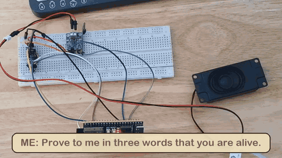
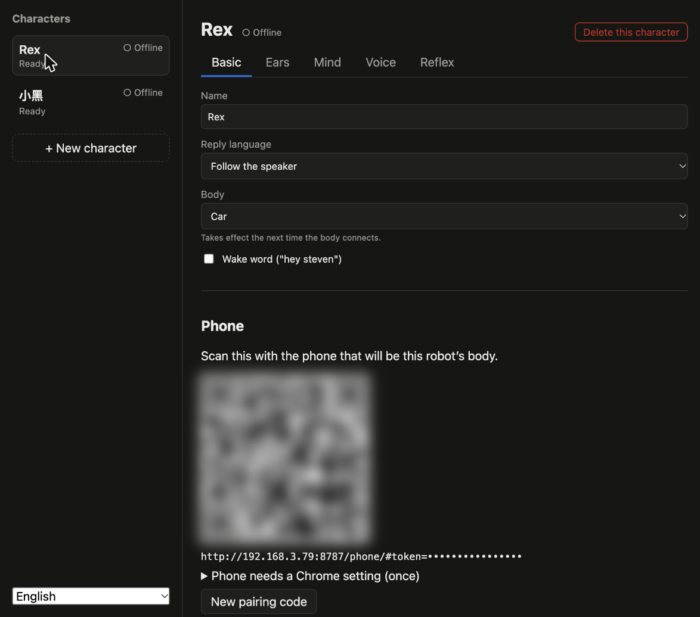
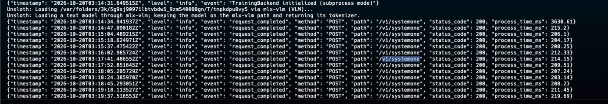
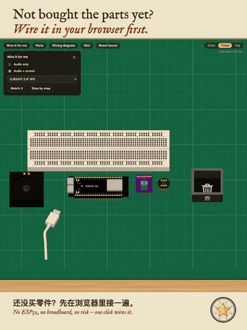

<p align="center"></p>

# bot-reborn

[English](README.md) | 中文

> **一个你自己配的大脑，一个让你在上面搭建的工作台。** 把一块 ESP32-S3 或一台旧手机
> 变成一个有嘴、有性格的机器人——接线、烧录、配置，全在一个本地服务里完成，而且可以
> 先不买任何零件。

<p align="center"><a href="https://youtube.com/shorts/Y80lk1O1Z-0"></a></p>

*让它用三个字证明自己还活着："两根铜线。"* —— [看这条 Short（有声）](https://youtube.com/shorts/Y80lk1O1Z-0)

## 你能搭出什么

已经有人在这套平台上搭出过三个成品，外加一条完全不用买零件的路。它们用的是同一个
大脑，只是身体不同。

- **一个会顶嘴的桌面伙伴。** 一块 ESP32-S3、一个麦克风、一个功放和喇叭，都用面包板
  连起来，再加一块屏当脸。[1 分钟](https://youtube.com/shorts/Y80lk1O1Z-0)
- **一辆听得懂话的小车。** 一个 4 美元的玩具、一台手机当身体，加一个 200 毫秒就能
  给出动作的反射模型。[40 秒](https://youtube.com/shorts/zPd0V5mH7p4)
- **一只屏幕上的宠物。** 会坐下、会握爪，没人跟它说话就自己趴下。
  [30 秒](https://youtube.com/shorts/zxbSJz2M2tY)
- **或者，先一个都不做：**[在浏览器里把线接一遍](#五分钟上手零硬件)。接错了烧的是
  虚拟零件，不是真零件。

是先有这几个成品，才有这套平台：[第一个是怎么做出来的](docs/story.md)。

## 大脑和它的角色

你电脑上跑的一个小 Node 服务就是大脑：它听、它理解、它决定、它说话。它带动的每个
机器人都叫一个**角色**——角色是数据不是代码，在 admin 页面里就是几栏，第二个角色还能
直接复制第一个角色的 provider，连 key 一起。

四层，每层单独选 provider、单独填 key：

- **耳朵** —— 语音转文字。
- **心智** —— 对话模型，加上 persona：它是谁、怎么说话、用什么语言。
- **声音** —— 文字转语音。
- **反射** —— 可选。你自己提供的决策模型先看每一句话，只挑一个动作，所以"停"是现在
  停，而不是等对话模型想完一轮再停。

耳朵、心智和声音这三层，任何 OpenAI 兼容的 provider 都能用；admin 页面自带常用
预设，边填边测 key。反射是个例外：它要的是一个本地决策模型的 endpoint，不是对话
provider。key 留在
你自己电脑上 `~/.bot-reborn/` 下一个只有你能读的文件里，只发给你选的那几家。机器人
看不到 key，它只持有一个说明"我是哪个角色"的 token。见
[安全](docs/development.md#security)。



### 拿反射当例子：一层是怎么配的

反射和其他三层一样，背后用什么模型由你决定：JEV 那一类决策模型、你自己训练并挂在
`/v1/systemone` 上的、或者就在同一台机器上跑一个小模型。平台不依赖你用哪一种。

不管用哪个，它都在对话模型看到一句话之前先读它，挑一个动作——`stop`、
`forward`、`backward`、`left`、`right`、`keep_going`——或者 `pass`，把这一轮交给
对话模型。它给的是概率不是文字，所以才能快：回复里没有语音，只有动作。

这个项目一直在用的那个是 0.8B 的模型，在 Mac mini M4 上从转写到动作约 200 毫秒。



它在测试集上 86.6%（164 条对 142 条）。实际用起来比这个数字好，因为动作只在置信度
超过 0.8 时才发出：拿不准的一律交给对话模型，慢一点，但不会把车带歪。**反射判错比
判慢糟得多。**

这个例子模型：

- **训练方法：** [Unsloth 的 decision model 配方](https://unsloth.ai/docs/basics/train-your-own-decision-model-with-unsloth)
- **数据集：**[`beasaltfish/robot-simple-commands`](https://huggingface.co/datasets/beasaltfish/robot-simple-commands) —— 由 [`training/commands/`](training/commands/) 生成
- **权重：**[`beasaltfish/robot-simple-commands-qwen3.5-0.8b`](https://huggingface.co/beasaltfish/robot-simple-commands-qwen3.5-0.8b)
  （[GGUF](https://huggingface.co/beasaltfish/robot-simple-commands-qwen3.5-0.8b-GGUF)）

这个例子只认英文。别的语言的指令应该分数偏低、落到对话模型上，但这条没测过。

## 工作台

接线模拟器就是浏览器里的一张工作台，地址是大脑所在机器上的 `/sim/`。它存在的意义是
让搭东西的头一个小时不花钱：

- **一根一根接**：坐进板子的引脚，另一头落进同一条 strip 上的空孔，网表是按你真连
  的东西算出来的。
- **Build it for me** 把音频那套直接接好留在台上；**Demo** 则用四十秒演一遍它是怎么接
  起来的。两种都可以撤销，让你自己再来一遍。
- **错误是有边界的，其中一些会烧掉虚拟零件**——电源接反是经典的一例。
- **十个器件家族**，每家配一节双语五阶段实验课，另有九个引导项目：搭出一个小东西，
  再自己检查。

<p align="center"><a href="https://youtube.com/shorts/0MMilmoEPdo"></a></p>

供电、电流、电平和总线检查都是有界的模型，不是 SPICE。固件支持情况单独列出，下面那张
表就是诚实的版本。固件工作台还能不碰真板子，对着虚拟台子编译并运行一段 sketch。

## 五分钟上手（零硬件）

1. **先把大脑跑起来**，放在和身体同一个 Wi-Fi 的电脑上。三条命令，先装 Node 20.19+ 或 22.12+。

   ```bash
   npm install
   npm run setup   # 拉唤醒词和 VAD 模型、检查 Node、构建一次
   npm start
   ```

   `npm run setup` 会告诉你缺什么、怎么补。浏览器会打开 admin 页面：先新建一个角色，
   再在 **听（Ears）**、**想（Mind）**、**说（Voice）** 里各填一家兼容 OpenAI 的
   服务和 key。
2. **打开工作台：**<http://localhost:8787/sim/>（admin 侧边栏也有入口）。它只在大脑
   所在的机器上能打开——工作台就是大脑自己的页面。
3. **还没有 key？** 打开 Projects，选 **Audio only（只有声音）**，再点「购物清单」。
   那是一份该买什么的清单，每件带着下单时要核对的规格和大概价格，可以直接打印。然后
   按 Demo 看它四十秒接好，或按 **Build it for me** 把台子留下，自己一根一根接。
4. **已经有 key？** 同样选 **Audio only**，按 Demo，等状态栏提示输入角色 token 时
   接受它。串口会替你输入并重启板子；看到 `welcomed as …` 之后，说一句话，等它回答。

不用零件、不用 key、不用硬件。想要真的那个，往下看。
目前只在 macOS 上完整走过；Windows 未测。

## 真实硬件

每个搭建都需要大脑、一台和身体同一个 Wi-Fi 的电脑，以及**语音转写、对话模型、
文字转语音的 API key**。

身体是 ESP32-S3：会听、会说、屏幕上有一只宠物狗，也能按定时动作驱动小车电机那四个
输入脚（GPIO 4–7）。

- 一块 **ESP32-S3** 开发板、一个 **INMP441** 麦克风、一个 **MAX98357A** 功放和一个
  喇叭，再加一块小 SPI 屏。引脚表在
  [`firmware/README.md`](firmware/README.md#wiring)。
- **Chrome 或 Edge** 和一根 USB 线。打开 admin 页面，把板子插到标着 **USB** 的口
  上，点 **Set up a board**：选 "First time" 会把固件、Wi-Fi 和角色 token 一起写
  进去，不用装 ESP-IDF。板子自己会找到大脑。
- 这个角色要把 **Barge-in 关掉**。这块身体没有回声消除，不关它会听见自己、打断自己。
- 要开玩具车，打开角色的 **基本 → 高级**，把身体设成 **会动的玩具**，接好那四个电机
  输入，再做校准：车往后走就 `cal drive`，转向反了就 `cal steer`。丢掉大脑一秒之内，
  板子会自己把车停下。

手机身体——一台安卓手机加一块 FT232H，也就是上面那些演示里开小车的那套——现在仍然
能用，但它不是这里的方向，这份 README 也不教它：
[`docs/hardware.md`](docs/hardware.md) 里有。暂时没有轮子的话，用 `?bench` 打开
admin，进角色的 **基本 → 高级**，把身体设成 **演练**，动作只会写进大脑的日志；
**只有声音** 就只是一个会说话的机器人。

## 什么能跑在哪

工作台建模的东西比真实固件实现的多——这是有意的。下表说明哪个是哪个：

| 器件 | 仿真 | 真实固件 | 实验课 |
|---|---|---|---|
| LED 和电阻 | 是 | — | 是 |
| 按钮（两脚） | 是 | — | 是 |
| 按钮模块（KY-004） | 是 | — | 是 |
| HC-SR04 测距 | 是 | — | 是 |
| BME280 环境 | 是 | — | 是 |
| SSD1306 OLED | 是 | — | 是 |
| SG90 舵机 | 是 | — | 是 |
| TB6612FNG + 直流电机 | 是 | — | 是 |
| WS2812 灯带 | 是 | — | 是 |
| 供电：USB、4×AA、实验电源、MB102 | 是 | 仅 USB | 是 |
| MPU-6050（塔罗魔杖） | 是 | 能读，未上真板验证 | — |

真实固件目前只实现了最初那套身体：INMP441 麦克风、MAX98357A 功放加喇叭、一块屏、
GPIO 4–7 那四个给小车用的电机脚，以及 I²C 上的 MPU-6050。表里其余的东西，工作台能
教，板子还跑不了。

### 一个身体能做什么

身体是模板，不是固件，也不是角色本身。[`core/bodies.js`](core/bodies.js) 里有五个：
只有声音、屏幕宠物、塔罗、会动的玩具，以及不放进选择里的演练（用 `?bench` 打开 admin
才看得到）。admin 的 **基本 → 高级 → 身体** 一张卡片一个模板：它有哪些能力——听、说、
显示、移动——每个身体花哪些零件，以及模型能调用哪些动作。

| 模板 | 能力 | 模型能调的动作 | 零件 |
|---|---|---|---|
| 只有声音（`none`） | 听、说 | `play_sound` | ESP32 板、麦克风、功放 |
| 屏幕宠物（`pet`） | 听、说、显示 | `pose`、`play_sound` | ESP32 板、麦克风、功放、屏 |
| 塔罗（`tarot`） | 听、说、显示 | `draw_card` | ESP32 板、麦克风、功放、屏、魔杖（可选） |
| 会动的玩具（`toy`） | 听、说、移动 | `move`、`cruise`、`stop`、`play_sound` | 玩具、ESP32 板、麦克风、功放 |
| 演练（`dry-run`） | 听、说、移动 | 玩具那四个 | 什么都不用：每个动词只写日志，不发给身体 |

动作是你自己的，在 **基本 → 高级 → 身体** 里用 JSON 改；一旦写下自己的动作，这个身体
就按你写的走，不再跟模板。模型随后拿到的是这些动作，外加上模板指定的固定工具（会说人话
的身体带上语言设置那一件），提示词也由这个身体自己的文字拼出来。这些都不用编译、不用刷固件：动作只是那五个硬件已经能执行的动词
组成的程序（`drive`、`halt`、`voice`、`pose`、`draw`）。零件表是另一半：它是购物
清单，由模板定死。

新角色默认只有声音；在这个设置出现之前写下的角色文件没有 `body` 键，仍然是会动的玩具
（[`core/config.js`](core/config.js)）。动词是什么、一个动作能写什么，见
[`docs/development.md`](docs/development.md#bodies-capabilities-verbs-actions)。

角色文件没有版本号。旧大脑读新版本写下的文件时，会静默丢掉它不认识的键——比如身体自带
的 `actions`——不报错，身体直接退回模板。请用写下角色时的那版大脑，回退版本没有迁移
步骤可做。

## 状态和边界

**ESP32 身体：** 在面包板上会听、会说、屏幕上有一只宠物狗，也能驱动玩具车的电机输入，
全部从 admin 页面配置。admin 里也能选屏了，但目前还没有型号通过真板验证，所以下拉框
是空的、并会直接说出来；在有人点亮并留下记录之前，先在串口里敲 `screen` 看列表，
再敲 `screen <id>` 和 `reboot`——选完要重启才生效。塔罗魔杖
在模拟器里能用；固件也读得到它，但还没在真板子上试过。

**手机身体：** 在一个机器人、一台手机上端到端跑通，保持原样。简单指令那套反射已经
用真人的声音在那辆车上验过，0.8 这个阈值站得住；bark 预设还只是第一次的猜测。手机
头重，倒车时把车带翻过。

有些硬件数字还没测。

## 更多

- [bot-reborn.agentlenshq.com](https://bot-reborn.agentlenshq.com) —— 二十秒看一遍工作台
- [`firmware/README.md`](firmware/README.md) —— ESP32 身体：引脚、烧录、配置
- [`docs/story.md`](docs/story.md) —— 这套平台是从哪个作品里长出来的
- [`docs/hardware.md`](docs/hardware.md) —— 小车接线、引脚图、每一项测量
- [`docs/esp32-lessons.md`](docs/esp32-lessons.md) —— 这块 ESP32 真出过的故障
- [`docs/development.md`](docs/development.md) —— 怎么读代码、怎么跑、测试、安全
- [`docs/instruments.md`](docs/instruments.md) —— 齿轮按钮后面那个校准页面
- [`docs/ui.md`](docs/ui.md) —— 机器人的脸，以及每种状态是什么意思
- [`docs/promo-video.md`](docs/promo-video.md) —— 拍那条片子学到的东西
- [`training/commands/`](training/commands/) —— 简单指令数据集，它的生成器和 model card

## 许可

[MIT](LICENSE)。`server/sounds/` 里的音效是 CC0——见它们的
[署名](server/sounds/CREDITS.md)。
