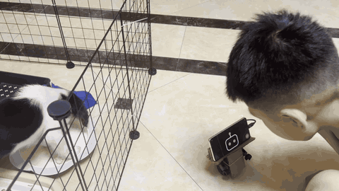
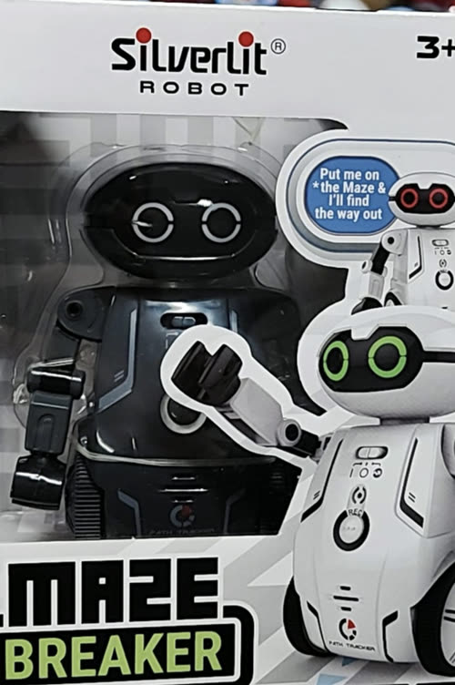
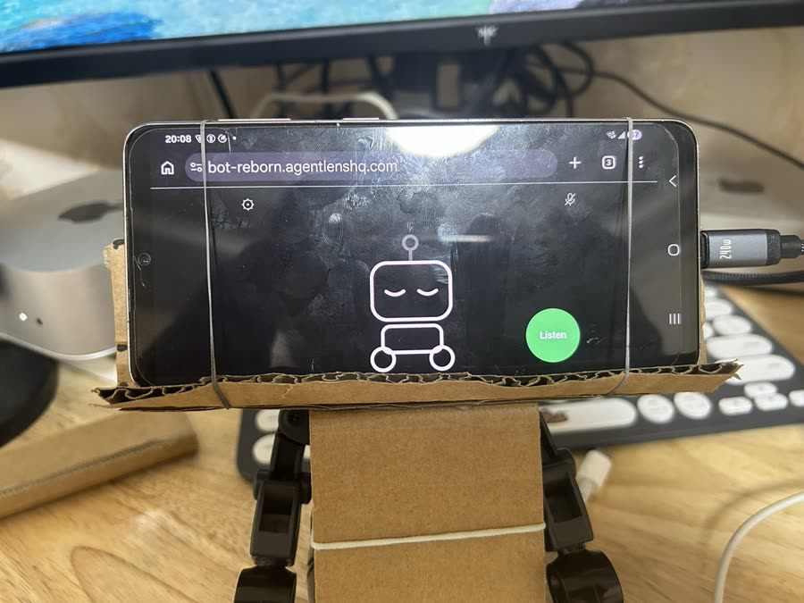
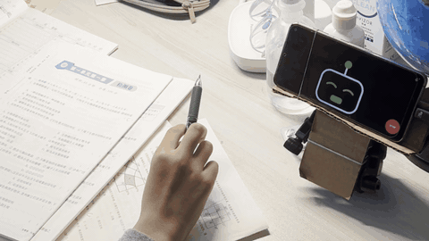
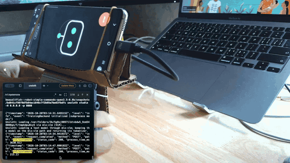
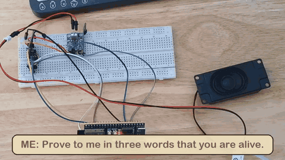
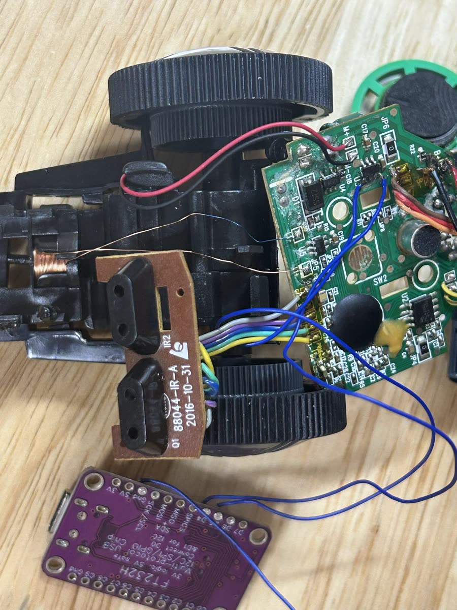

# The build story

This is the record of one gadget built on bot-reborn — a $4 toy robot turned
into an AI robot that talks back. It is kept because the platform came out of
it: every part of the workbench exists because this build needed it.

## The toy it started as

**Turn a $4 toy robot into an AI robot, with an old phone as its body and your
computer as its brain.**

*Real dog: busy eating. Robot dog: on duty.* — [watch the Short, with sound](https://youtube.com/shorts/SNA9ok1j0Sg)

The whole build story, in long form:
[I turned a $4 toy robot into an AI robot that talks back](https://agentlenshq.com/maker/four-dollar-robot)

<table>
  <tr>
    <td align="center"></td>
    <td align="center"></td>
  </tr>
  <tr>
    <td align="center">Before: a line-following toy</td>
    <td align="center">After: the head is gone, the phone is the face</td>
  </tr>
</table>

## What it does out of the box

<table>
  <tr>
    <td align="center" width="50%"> Kid: has questions. Robot: has attitude.</td>
    <td align="center" width="50%"> A spoken move, answered in about 200 ms by a 0.8B model on the computer — no LLM call.</td>
  </tr>
  <tr>
    <td align="center" width="50%"> Asked to prove it's alive in three words: "Two copper wires."</td>
    <td align="center" width="50%"> Now it has a face, and it listens: a dog on a $2 screen, no buttons, just a voice.</td>
  </tr>
</table>

Each GIF links to its Short, with sound.

## Why a phone first

The toy's own line-following chip is cut out of the loop. Four wires from the
FT232H go straight to the inputs of the toy's motor driver and steering coil,
and the phone switches those four pins over USB. The phone is the robot's
body: it listens, plays, drives and shows a face. Everything that decides —
hearing its name, understanding, choosing what to do, talking back — runs in a
small Node server on a computer on the same Wi-Fi, the robot's brain.

## Why an ESP32 now

The brain started out inside the phone's browser and moved to the computer for
two reasons: everything that hears you can, in time, run locally on your own
machine — the reflex model already does — and the body can shrink to something
much smaller than a phone. A phone, it turns out, is heavy enough to tip the
car over when it backs up.

That smaller body is an ESP32-S3. It hears, talks, shows a pet dog on a small
screen and drives the toy's motor inputs — though the breadboard rig in the
demos has no wheels mounted yet. You flash and set it up from the admin page in
Chrome, over one USB cable, and it finds the brain on its own.
