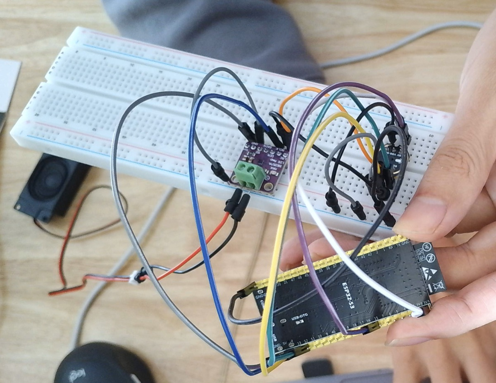

# ESP32-S3 body

Firmware that makes an ESP32-S3 a body for the brain (`npm start`): it streams
its microphone up, plays what the brain sends down, runs timed `move`s on the
car's motor driver inputs, and stops the car within a second of losing the
brain. Design: `docs/superpowers/specs/2026-10-20-esp32-body-firmware-design.md`.

## Wiring

Pins live in `main/board.h` and nowhere else. Defaults:

| Signal | GPIO | To |
|---|---|---|
| drive A / B | 4 / 5 | U3 inputs (were FT232H D4 / D5) |
| steer A / B | 6 / 7 | U5 **inputs**, never the coil (were D6 / D7) |
| I2S BCLK | 12 | INMP441 SCK + MAX98357A BCLK |
| I2S WS | 13 | INMP441 WS + MAX98357A LRC |
| I2S out | 14 | MAX98357A DIN |
| I2S in | 15 | INMP441 SD (its L/R pin to GND) |
| status LED | 21 | LED + resistor to GND |



### Audio, pin by pin

The two audio chips share one I2S bus: BCLK and WS go to both, so put each on
a breadboard row and fan out from there. On the usual ESP32-S3 DevKitC clone
(two USB-C ports) GPIO 4–7 and 12–15 are all on the header that also carries
3V3, 5V and GND.

| INMP441 (mic) | ESP32-S3 |
|---|---|
| VDD | 3V3 (not 5V: the mic is rated 3.6 V max) |
| GND | GND |
| SCK | GPIO 12 |
| WS | GPIO 13 |
| SD | GPIO 15 |
| L/R | GND: the mic then talks in the left slot, which is the one the firmware reads |

| MAX98357A (amp) | ESP32-S3 |
|---|---|
| Vin | 5V (louder) or 3V3 |
| GND | GND |
| BCLK | GPIO 12 |
| LRC | GPIO 13 |
| DIN | GPIO 14 |
| GAIN | unconnected (9 dB) |
| SD | unconnected (on, both channels mixed) |
| + / − | the speaker, through the screw terminal |

If the recording comes back wrong, two things already bit this build and are
fixed in `audio.c`, in case you port it:

- **Twice the length, or every other sample silent.** On the S3 a mono I2S rx
  channel still reads both slots unless told `I2S_STD_SLOT_LEFT`.
- **Clicks and hiss with the level otherwise right.** BCLK/WS at full drive
  ring on jumper wires and the mic counts one clock edge twice; the firmware
  drops both pins to the weakest drive. Shorter wires help too.

To check a recording without your ears, `rec out.wav 5` on the fake brain
(below) and look at the numbers: 5 s long at 16 kHz, speech around −30…−20
dBFS RMS, no samples at ±32767 (clipping), and no jump of more than half the
range between neighbouring samples (a glitch).

Before the car board: measure `docs/hardware.md` ③ (pull-downs on the motor
inputs — if none, solder 10 kΩ from each to GND; the ESP32's own pull-downs
only exist once the firmware runs) and ④ (the board's logic threshold — if
3.3 V is not enough, add a level shifter such as a 74HCT245).

## Build and flash

Once per machine: ESP-IDF v5.4.1 in `~/esp/esp-idf` (`./install.sh esp32s3`).

```sh
. ~/esp/esp-idf/export.sh
cd firmware
idf.py set-target esp32s3     # once
idf.py build flash monitor    # Ctrl-] leaves the monitor
```

## Set up over serial

In `idf.py monitor`, type:

```
wifi "My Home" mypassword
token 0123456789abcdef0123456789abcdef
url ws://192.168.3.79:8787/body
reboot
```

The token is the character's, from the admin page. `npm start` prints the
body URL. Then calibrate, drive first (a car wired backwards turns the wrong
way while you watch it): `cal drive` if it went backwards, then `cal steer` if
it turned the wrong way. `cal` shows both; `help` lists everything.

In the admin page, give this character **Body: Car** and turn **Barge-in
off**: there is no echo cancellation on this body, and with barge-in on the
robot would hear itself and interrupt itself.

## Status light

| Light | Means |
|---|---|
| fast blink | no Wi-Fi |
| short blink each second | looking for the brain |
| slow on/off (1 s) | the brain refused it; the reason is on serial; fix it and `reboot` |

`busy` alone is retried for 15 s first: it is usually the brain still holding
the connection a Wi-Fi blip broke. Busy for longer means another body is using
this character's token.
| a blip every 3 s | sleeping |
| steady | listening or speaking |
| quick flicker | hearing you |
| even blink | thinking |

## Bench without the brain

```sh
node server/tools/fake-brain.js --token <hex>
```

Type `move forward left 600`, `stop`, `hush`, `state THINKING`, `tone 1000`,
`say file.wav`, `rec out.wav 5`, `status`. While the body streams, a line a
second shows bytes and level: speech should read −35…−15 dBFS; quieter, lower
`MIC_SHIFT` in `board.h` (14 = ×4) and flash again.

## Tests

`npm run firmware:test` builds `components/body_logic` (everything that does
not touch hardware) on this computer and runs its tests. The protocol cases
in `test/brain-messages.json` are checked against `core/protocol.js` too.
